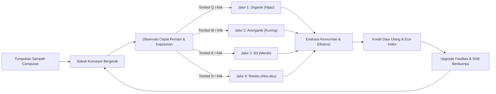

# GAME DESIGN DOCUMENT (GDD)
# EcoSort: Fasilitas Sirkular (4-Way Circular Facility)

---

## 1. Executive Summary & Visi Game
* **Judul Game**: *EcoSort: Fasilitas Sirkular* (Working Title)
* **Genre**: *Fast-Paced Action-Puzzle & Conveyor Logistics Management*
* **Platform**: Web Browser Desktop/PC (HTML5 / Phaser 3)
* **Target Pemain**: Siswa SMP – SMA (Usia 12–17 tahun)
* **Waktu Sesi**: 3–4 menit per shift/level, total durasi ~15–20 menit untuk 5 level utama.
* **Core Fantasy**: Pemain berperan sebagai *Chief Sorting Specialist* di fasilitas pemulihan material modern (Material Recovery Facility / MRF) kota cerdas yang bertanggung jawab mengarahkan arus sampah kota berkecepatan tinggi ke 4 jalur sirkular yang tepat.

---

## 2. Integrasi Pembelajaran (Learning by Doing)
Game ini **bukan kuis pilihan ganda**. Edukasi diintegrasikan langsung ke dalam mekanika permainan dan konsekuensi fisik/sistemik dari tiap aksi:

| Kategori Sampah | Kode Warna & Ikon | Contoh Item Nyata | Konsekuensi Jika Benar | Konsekuensi Jika Salah Sortir |
| :--- | :--- | :--- | :--- | :--- |
| **1. Organik** | 🟢 Hijau (Daun/Tunas) | Sisa sayur & buah, sisa nasi, ampas kopi, daun kering, tulang ikan | Masuk biodigester/komposter $\rightarrow$ menghasilkan pupuk & gas metana untuk listrik fasilitas. | Masuk jalur daur ulang $\rightarrow$ mengotori kertas/plastik (kontaminasi fatal). |
| **2. Anorganik Daur Ulang** | 🟡 Kuning (Simbol Daur Ulang) | Botol PET bening, kardus kering, kaleng aluminium, botol kaca sirup | Masuk baler & shredder $\rightarrow$ dipress menjadi bahan baku industri sirkular bernilai ekonomi. | Masuk komposter $\rightarrow$ tidak terurai, merusak mesin pengolah pupuk. |
| **3. B3 (Bahan Berbahaya & Beracun)** | 🔴 Merah (Tengkorak / Hazard) | Baterai bekas, lampu neon/TL, botol pestisida/cairan pembersih kimia, kaleng aerosol, e-waste (kabel/PCB bekas) | Masuk kontainer netralisasi khusus berstandar lingkungan (Hazardous Safe Vault). | **Kritis!** Masuk jalur umum memicu insiden (ledakan kecil, percikan api, atau kebocoran racun yang menghentikan conveyor). |
| **4. Residu** | ⚪/🔘 Abu-abu (Tong Akhir) | Sachet kemasan kopi/mi instan (multilayer foil), popok/pembalut bekas, styrofoam kotor/berminyak, pecahan keramik, puntung rokok | Diarahkan ke jalur RDF (*Refuse Derived Fuel*) / sanitary landfill terstandar. | Masuk jalur daur ulang $\rightarrow$ merusak filamen daur ulang karena plastik komposit tidak bisa dilelehkan bersama plastik murni. |

### Prinsip Edukasi Kritis:
1. **Dilema Kontaminasi Nyata**: Membedakan kemasan murni vs komposit (misal: botol plastik bersih = *Anorganik Daur Ulang*, sedangkan sachet kopi berlapis aluminium foil = *Residu*).
2. **Kondisi Material**: Kardus bersih = *Anorganik*, tetapi kardus basah bersimbah minyak goreng = *Residu*.
3. **Protokol Bahaya Nyata**: Mengapa baterai bekas tidak boleh dibuang bersama kertas atau sampah dapur (risiko kebakaran litium & pencemaran logam berat merkuri).

---

## 3. Core Gameplay Loop

1. **Inflow**: Sampah muncul secara berkelanjutan di sabuk berjalan (*conveyor belt*) dari sisi kiri menuju kanan dengan kecepatan dinamis.
2. **Assessment**: Pemain mengidentifikasi fisik sampah dalam hitungan detik.
3. **Action**: Pemain menekan hotkey (Q/W/E/R atau 1/2/3/4) atau mengklik/menggeser tuas *diverter gate* saat sampah melintasi persimpangan sensor.
4. **Outcome**:
   * *Akurat*: Poin sirkular bertambah, indikator kepuasan fasilitas naik, efek visual pemrosesan berjalan mulus.
   * *Meleset / Salah Jalur*: Indikator kontaminasi naik, ada peringatan visual/audio. Jika B3 salah masuk, memicu penalti darurat.
5. **Level Clear**: Bertahan selama durasi shift (2–3 menit) dengan tingkat kemurnian (*purity rate*) $\ge 80\%$.

---

## 4. Mekanika Permainan & Kontrol Pemain (Overhauled: Drag & Drop + Click to Sort)

### 4.1 Metode Kontrol (Intuitif & Ergonomis)
* **Metode 1: Drag & Drop Langsung (Direkomendasikan)**:
  * Pemain mengklik dan menyeret (*drag*) sampah yang bergerak di sabuk konveyor langsung ke salah satu dari 4 Tong Sampah Besar di sudut layar.
  * Saat sampah melayang di atas tong, tong akan menyala terang (*drop target highlight*).
  * Lepaskan klik (*drop*) untuk memasukkan sampah ke tong.
* **Metode 2: Klik Sampah $\rightarrow$ Klik Tong (Click to Pick)**:
  * Klik sampah pada konveyor untuk memilihnya (lingkaran cahaya seleksi aktif).
  * Klik tong tujuan untuk menerbangkan sampah ke tong tersebut.
* **Metode 3: Keyboard Expert Hotkeys (`Q`, `W`, `E`, `R`)**:
  * `[Q]`: Masukkan ke **Tong ORGANIK** (🟢 Hijau, Kiri Atas).
  * `[W]`: Masukkan ke **Tong DAUR ULANG** (🟡 Kuning, Kanan Atas).
  * `[E]`: Masukkan ke **Tong B3 (BAHAYA)** (🔴 Merah, Kiri Bawah).
  * `[R]`: Masukkan ke **Tong RESIDU** (🔘 Abu-abu, Kanan Bawah).

### 4.2 Onboarding Interaktif (Guided First Step)
* Pada **Shift 1**, game membekukan waktu saat sampah pertama (Sisa Apel) mencapai tengah konveyor.
* Muncul animasi panah dan petunjuk ramah: *"Seret sampah ini ke Tong Organik Hijau di atas-kiri!"*.
* Begitu pemain mencoba dan berhasil, game memberikan konfeti selebrasi dan shift berjalan normal.

### 4.2 Mekanika Sekunder (Interaksi Khusus)
* **Decontamination Quick-Action**:
  * Beberapa botol plastik masih berisi sisa cairan $\rightarrow$ klik ganda cepat untuk mengosongkan sebelum dibelokkan ke anorganik.
* **Hazard Alert Protocol**:
  * Sampah B3 memiliki visual bercahaya/tanda peringatan berdenyut. Pemain harus memprioritaskan B3 agar tidak terbawa ke ujung conveyor.
* **Conveyor Jam & Overload**:
  * Jika pemain ragu-ragu dan sampah menumpuk di ujung konveyor tanpa tersortir, mesin akan macet sementara dan menimbulkan tumpukan penalti.

---

## 5. Struktur Level & Kurva Kesulitan

| Level / Shift | Nama Shift | Fokus Pembelajaran | Dinamika Gameplay | Syarat Menang |
| :--- | :--- | :--- | :--- | :--- |
| **Shift 1** | *Inisiasi Pemilahan* | Organik vs Anorganik murni (dasar 3R) | Konveyor lambat, hanya 2 kategori aktif, volume rendah. | Purity $\ge 80\%$, Sortir $\ge 25$ item |
| **Shift 2** | *Protokol Bahaya (B3)* | Limbah elektronik, baterai, zat kimia | Kategori B3 mulai masuk. Konveyor bertambah cepat. Salah sortir B3 memicu alarm. | Purity $\ge 85\%$, 0 Insiden B3 |
| **Shift 3** | *Realita Residu Kota* | Membedakan Anorganik Daur Ulang vs Residu multilayer/sachet | Kategori ke-4 (Residu) aktif. Sampah yang mirip (misal kemasan sachet) mulai muncul. | Purity $\ge 85\%$, Sortir $\ge 50$ item |
| **Shift 4** | *Kondisi Ekstrem (Hujan & Pasar)* | Kardus basah berminyak, botol berisi sisa cairan, sampah campuran | Muncul item kontaminasi yang butuh tindakan cepat sebelum dipilah. Kecepatan variabel. | Purity $\ge 88\%$, Waktu 180 detik |
| **Shift 5** | *Sirkularitas Total (Zero Waste)* | Manajemen penuh 4 lini dengan throughput tinggi | Volume maksimal dari seluruh distrik kota. Ujian refleks dan pemahaman klasifikasi materi. | Purity $\ge 90\%$, Skor Bintang 3 |

---

## 6. Umpan Balik (Feedback) & Audio-Visual State
* **Positive Feedback**:
  * Efek visual partikel berkilau (*chime/pop*) saat sampah masuk ke hopper yang benar.
  * Latar belakang fasilitas tampak bersih, turbin komposter berputar, lampu hijau menyala.
* **Negative Feedback**:
  * Suara *thud/buzz* rendah saat kontaminasi terjadi.
  * Teks melayang informatif: *"Kardus berminyak tidak bisa didaur ulang! (Residu)"*.
  * Layar bergetar ringan (*screen shake*) jika B3 masuk ke insinerator atau komposter.
* **HUD Informatif**:
  * *Purity Gauge* (Persentase Kemurnian Real-time).
  * *Circular Score* (Kredit Daur Ulang yang didapat).
  * *Hazard Indicator* (Jumlah toleransi insiden B3: maks 3 kesempatan).
  * *Shift Progress Bar* (Sisa waktu atau sisa kuota batch).

---

## 7. Replayability & Nilai Tambah
* **Mode "Overtime Rush" (Endless Mode)**: Terbuka setelah menyelesaikan Shift 5. Konveyor makin cepat hingga pemain membuat 3 kesalahan fatal. Skor dapat dicatat untuk kompetisi skor tertinggi antarsiswa di kelas.
* **Eco-Catalog (Ensiklopedia Sampah Interaktif)**: Tiap kali pemain pertama kali menemukan sampah baru, item tersebut tercatat di katalog dengan penjelasan sains di baliknya (misal: kenapa puntung rokok butuh 10 tahun terurai dan termasuk residu).

---

## 8. Persetujuan Desain Game (GDD)
Dokumen ini menjadi acuan mutlak untuk penyusunan visual, UI/UX, dan implementasi teknis berikutnya.
