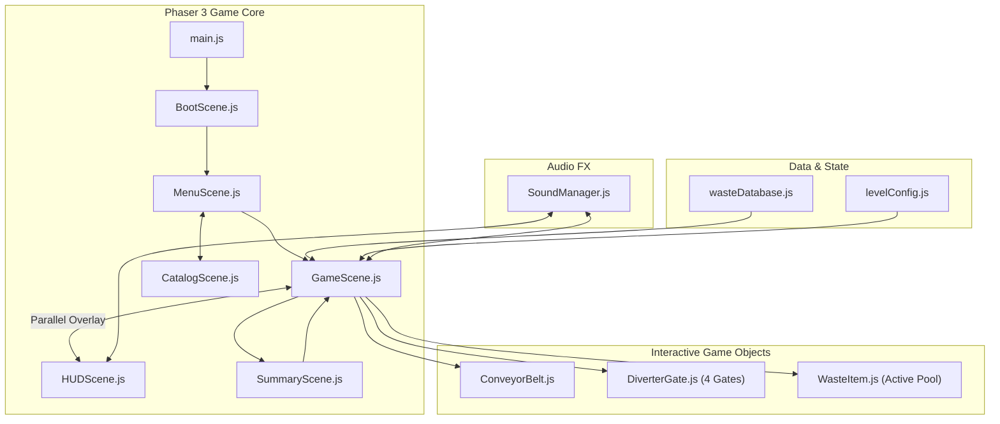

# IMPLEMENTATION PLAN (IMPLEMENTATION_PLAN.md)
# EcoSort: Fasilitas Sirkular (Phaser 3 + Vite Modular Architecture)

---

## 1. Lingkungan & Pemilihan Teknologi
* **Runtime**: Node.js (v22.22.0) & npm (v10.9.4)
* **Build Tool & Dev Server**: **Vite 6** (Ultra-fast HMR, bundling efisien, zero latency untuk browser preview)
* **Game Engine**: **Phaser 3 (v3.87+)**
  * *Alasan Pemilihan*: Engine standar industri untuk game web 2D; mendukung WebGL dengan fallback Canvas otomatis; manajemen scene terisolasi; particle engine bawaan; tweening canggih; sangat hemat memori di komputer lab sekolah.
* **Audio Engine**: Hybrid Web Audio API procedural synthesizer (`SoundManager.js`) yang menjamin 0-lag audio, bebas ketergantungan file MP3 eksternal besar yang lambat di-download, dan menghasilkan umpan balik suara taktil (klik tombol, alarm B3, chime sirkular, deru konveyor).

---

## 2. Struktur Modul & File (Multi-File Architecture)

```
c:\laragon\www\mpi\game2\
├── index.html                     # Entry HTML dengan viewport setup dan font loader
├── package.json                   # Definisi script Vite & dependencies Phaser
├── vite.config.js                 # Konfigurasi server lokal dan asset base path
├── assets/                        # Direktori aset visual hasil generate
│   ├── backgrounds/               # Ilustrasi ruangan pabrik & kota hijau
│   ├── environment/               # Tekstur konveyor & gerbang mekanis
│   ├── items/                     # Sprite item sampah 4 kategori (Organik, Daur Ulang, B3, Residu)
│   └── ui/                        # Ikonografi dan tombol kustom
├── src/
│   ├── main.js                    # Inisialisasi Phaser.Game instance & config
│   ├── config.js                  # Konstanta global, ukuran canvas 1280x720, token warna
│   ├── data/
│   │   ├── wasteDatabase.js       # Basis data lengkap item sampah (nama, kategori, fakta ilmiah)
│   │   └── levelConfig.js         # Konfigurasi kuota, kecepatan konveyor, dan komposisi 5 Shift
│   ├── scenes/
│   │   ├── BootScene.js           # Preloader aset dengan visual progress bar bertema daur ulang
│   │   ├── MenuScene.js           # Menu utama interaktif dengan animasi konveyor latar
│   │   ├── GameScene.js           # Loop gameplay inti: pergerakan konveyor, mekanika sortir, collision
│   │   ├── HUDScene.js            # Overlay UI terpisah: Purity Gauge, Timer LED, Hazard Indicator, Tombol Q/W/E/R
│   │   ├── SummaryScene.js        # Laporan audit shift, kalkulasi bintang, dan catatan supervisor
│   │   └── CatalogScene.js        # Ensiklopedia interaktif sampah kota
│   ├── objects/
│   │   ├── ConveyorBelt.js        # Komponen sabuk berjalan dengan scrolling chevron
│   │   ├── DiverterGate.js        # Komponen 4 gerbang mekanik dengan animasi pegas (bounce easing)
│   │   └── WasteItem.js           # Kelas item sampah (fisika gerak, tipe, state, dan partikel)
│   ├── audio/
│   │   └── SoundManager.js        # Synthesizer audio prosedural Web Audio API
│   └── utils/
│       └── Easing.js              # Formula transisi dan helper matematika
```

---

## 3. Alur Komunikasi Antar-Komponen (Architecture Data Flow)


---

## 4. Rencana Implementasi Bertahap (Milestone Plan)

### Milestone 1: Fondasi Proyek & Scaffolding
* Konfigurasi `package.json` dan `vite.config.js`.
* Buat `index.html` dan `src/main.js` serta `src/config.js`.
* Buat `src/data/wasteDatabase.js` dengan data edukasi 12 item sampah representatif.
* Buat `src/audio/SoundManager.js` untuk audio reaktif tanpa file suara eksternal.

### Milestone 2: Sistem Aset & Scene Preloader
* Integrasi aset visual dari Phase 8 ke dalam `assets/`.
* Implementasi `BootScene.js` untuk memuat seluruh sprite dan audio synthesizer.
* Implementasi `MenuScene.js` dengan antarmuka awal bertema industrial modern.

### Milestone 3: Core Mechanical Gameplay (Vertical Slice)
* Implementasi `ConveyorBelt.js` (sabuk berjalan dinamis).
* Implementasi `DiverterGate.js` (4 gerbang dengan hotkey Q/W/E/R dan pointer click).
* Implementasi `WasteItem.js` (spawning, translasi kecepatan, penentuan sorting, dan efek partikel).
* Implementasi `HUDScene.js` (Purity gauge, LED hazard 3 kesempatan, skor, tombol interaktif).

### Milestone 4: Siklus Evaluasi & Edukasi
* Implementasi `SummaryScene.js` (tampilan audit lembar kerja lingkungan, bintang 1-3, fakta ilmiah edukatif).
* Implementasi `CatalogScene.js` (ensiklopedia sampah).

### Milestone 5: Polishing, QA & Verifikasi Playable
* Pengujian interaksi keyboard dan mouse.
* Validasi akurasi kategori edukatif (Organik, Daur Ulang, B3, Residu).
* Uji performa 60 FPS dan penanganan error browser.

